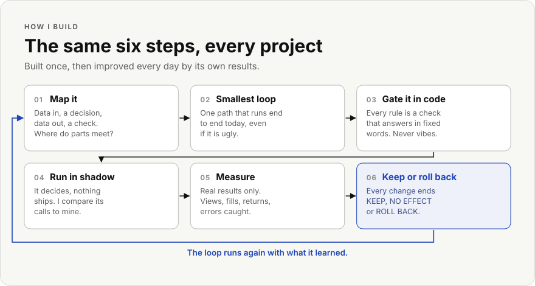

# Andrew James Johnson

**B.S. Finance, University of Utah, May 2027 · Salt Lake City and Chanhassen, MN**

I grew up around finance and I work as an analyst first: financial modeling, valuation and markets. I use AI to get more of that work done, and I build it the way a firm runs. Every role gets its own written workflow, every rule becomes a check in code, and a person signs off on anything that matters. The biggest project runs a full fund research desk privately, on hardware the fund owns.

**Open to:** 2027 analyst internships and full time roles in finance, defense, government and AI.

## Projects

| Project | What it is | Proof |
|---|---|---|
| **[Mac Studio Prepared](https://github.com/andrewjamesjohnson/mac-studio-prepared)** | A hedge fund research desk with 120 seats on four Mac Studios. Every seat has a written workflow, and private data never leaves the building. | 94 reports, 113 scheduled jobs, 29 formulas, 7,107 tests |
| **[Project Echo](https://github.com/andrewjamesjohnson/project-echo)** | A local research tool for investors, built for my brother: transcribes earnings calls, podcasts and live TV on your own machine, marks who is speaking, and makes it all searchable. | 185 tests; an 80 minute podcast transcribes in about six minutes on a laptop |
| **[Finance Models](https://github.com/andrewjamesjohnson/finance-models)** | Portfolio optimizer, bonds, factor models, pro formas, and an options pricer (Black-Scholes, implied volatility, American trees) in Python and Excel. | Option prices match Hull's published answers; Excel and Python agree to the last decimal |
| **[Congress Stock Scorecard](https://github.com/andrewjamesjohnson/congress-stock-scorecard)** | How members of Congress did with their stocks, every market morning, from public filings. | Streams a 15 GB market file through a small C reader each morning |
| **[The Clip Factory](https://github.com/andrewjamesjohnson/clip-factory)** | A media operation that finds, cuts and posts video on YouTube, Facebook, Instagram and TikTok, with my approval on every clip. | 1,435 commits in 5 weeks, 6,222 tests, 51 scheduled jobs |
| **[The Library Agent](https://github.com/andrewjamesjohnson/library-agent)** | Finds public domain books on Project Gutenberg and the Internet Archive, reads them, and answers with the chapter and paragraph behind every sentence. | Every citation checked in code before an answer prints |
| **[The Job Bot](https://github.com/andrewjamesjohnson/job-bot)** | Finds entry level roles on 1,801 company boards, picks the right resume and fills the form. I press Submit. | 570 roles lined up in its first 3 days |
| **[Loop Engineering](https://github.com/andrewjamesjohnson/loop-engineering)** | How I build these systems, on one page. | 402 gate refusals in a week, counted by rule |

## Mac Studio Prepared

Most AI work today runs through someone else's servers, one chat at a time. This desk works differently. Each of its 120 seats has a charter that says what it owns, what done looks like and where it has to stop, so any task goes to the seat built for it. Everything runs on open weight models on four Studios the fund owns, and as those models get better, the same machines do more. [Every seat](https://github.com/andrewjamesjohnson/mac-studio-prepared/blob/main/docs/AGENTS.md) · [every report](https://github.com/andrewjamesjohnson/mac-studio-prepared/blob/main/docs/REPORTS.md) · [the formulas](https://github.com/andrewjamesjohnson/mac-studio-prepared/blob/main/docs/FORMULAS.md)

## At Quasar Markets

I was Head of Data Intelligence, Media and Growth at Quasar Markets, a financial data and research platform, from August 2025 to November 2026. What I built there belongs to the company, so none of it is in these repos. In short:

| Work | What it was |
|---|---|
| **World Data Intelligence** | 206 countries and territories and every US state, mapped by sector, so an agent knows where each of 220,000+ sources lives |
| **300+ agents** | Agents that took over about half the company's work, from email and social to project delivery |
| **70+ modules** | UI and UX for engineering to build, from Quasar Exchange, the client trading platform, to trackers for opening bells, earnings calls and chart patterns |
| **Media and investor relations** | Booked the NYSE, Schwab Network, Yahoo Finance, X and Roku TV, with live streams that peaked at 102,000 viewers, and helped run two raises |

## How I build

Every project starts the way a finance process does: what comes in, what gets decided, what goes out and what checks it. Things usually break where two parts meet, even when each part was built right, so every hand off gets its own check. [Loop Engineering](https://github.com/andrewjamesjohnson/loop-engineering) has the method on one page.

## Recommendation

> "Andrew is naturally curious, persistent, and resourceful."
>
> **Steven E. Orr**, Founder and CEO, Quasar Markets

[Read the full letter (PDF)](https://github.com/andrewjamesjohnson/.github/blob/main/letters/steven-orr-letter.pdf)

## Skills

**Finance:** financial modeling · valuation · pro forma statements · portfolio construction (Markowitz, factor models) · fixed income (duration, immunization) · risk (VaR, stress tests) · fund operations · Advanced Excel

**Technology:** Python · SQL · Git · agent design and orchestration · human in the loop workflows · evaluation and guardrails · frontier and local open weight models

## About

- **Now:** independent, building research and automation systems for finance firms
- **Before:** Head of Data Intelligence, Media and Growth at Quasar Markets, the youngest of eight by more than 25 years
- **School:** B.S. Finance, Finance emphasis, University of Utah, expected May 2027
- **Next:** buying the four Mac Studios and running the desk on real data

[LinkedIn](https://www.linkedin.com/in/andrewj3)

Mac Studio Prepared, inside the desk's app: every seat at its console.
