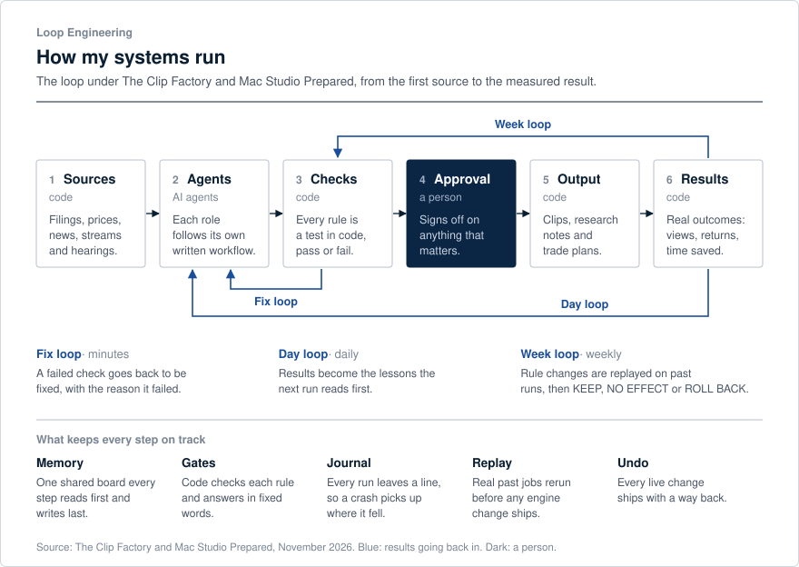
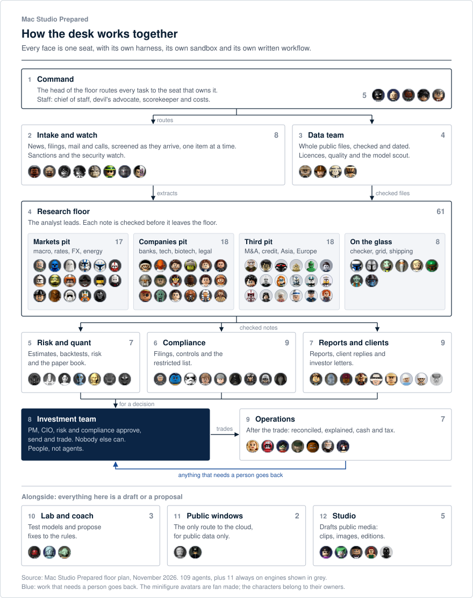

# Andrew James Johnson

**B.S. Finance, University of Utah, May 2027 · Salt Lake City, UT and Chanhassen, MN**

I grew up around finance and I work as an analyst first: financial modeling, valuation and markets. I use AI to get more of that work done, and I build it the way a firm runs. Every role gets its own written workflow, every rule becomes a check in code, and a person signs off on anything that matters. My biggest project, Mac Studio Prepared, is a full fund research desk built to run privately, on hardware the fund owns.

**Open to:** 2027 analyst internships and full time roles in finance, defense, government and AI.

**Code:** the project repositories are private. To see them, [request access](https://github.com/andrewjamesjohnson/.github/issues/new?template=request-access.yml) with your GitHub account.

## How I build

Every project starts the way a finance process does: what comes in, what gets decided, what goes out and what checks it. Things usually break where two parts meet, even when each part was built right, so every hand off gets its own check. [Loop Engineering](https://github.com/andrewjamesjohnson/loop-engineering) has the full method.

## Projects

The repositories are private. [Request access](https://github.com/andrewjamesjohnson/.github/issues/new?template=request-access.yml) with your GitHub account and I will get back to you.

| Project | What it is | Proof |
|---|---|---|
| **[Mac Studio Prepared](https://github.com/andrewjamesjohnson/mac-studio-prepared)** | A hedge fund research desk with 120 seats on four Mac Studios. Every seat has a written workflow, and private data never leaves the building. | 94 reports, 113 scheduled jobs, 29 formulas, 7,107 tests (I charge to set this up for a fund; [walkthrough on request](https://www.linkedin.com/in/andrewj3)) |
| **[The Clip Factory](https://github.com/andrewjamesjohnson/clip-factory)** | A media operation that finds, cuts and posts video on YouTube, Facebook, Instagram and TikTok. I run it from [Clip Review](https://github.com/andrewjamesjohnson/clip-factory#clip-review), an app I built for approvals, analytics from the platforms' own APIs, and paid campaigns. | 1.6 million views in the last 28 days; 1,435 commits in 5 weeks, 6,222 tests, 51 scheduled jobs (I charge to set this up for a client) |
| **[Loop Engineering](https://github.com/andrewjamesjohnson/loop-engineering)** | The workflow, the checks and the feedback loops behind these projects. | 402 gate refusals in a week, counted by rule |
| **[Agent Prompt Library](https://github.com/andrewjamesjohnson/agent-prompt-library)** | 463 research prompts for an investment firm, sorted into 16 tasks across 15 asset classes and 9 equity sectors. Pick the task, type the ticker and paste it into the firm's AI model. | Every prompt has a role, a method, named sections, a verdict and ground rules for its figures, checked in code; a command line tool and an MCP server. |
| **[World Data Sources](https://github.com/andrewjamesjohnson/world-data-sources)** | Where the official data lives for 205 countries and territories and every US state, in 50 sectors. One file per place, so an AI agent goes straight to the publisher instead of searching the web. | 237,399 source listings and 24,096 cited figures; a command line tool and an MCP server. |
| **[Congress Stock Scorecard](https://github.com/andrewjamesjohnson/congress-stock-scorecard)** | How members of Congress did with their stocks, every market morning, from public filings. | Streams a 15 GB market file through a small C reader each morning |
| **[Finance Models](https://github.com/andrewjamesjohnson/finance-models)** | Portfolio optimizer, bonds, factor models, pro formas, and an options pricer (Black-Scholes, implied volatility, American trees) in Python and Excel. | Option prices match Hull's published answers; Excel and Python agree to the last decimal. [Try the Excel model](https://github.com/andrewjamesjohnson/finance-models/raw/main/options/options_pricer.xlsx) |
| **[Project Echo](https://github.com/andrewjamesjohnson/project-echo)** | A local research tool for investors, built for my brother: transcribes earnings calls, podcasts and live TV on your own machine, marks who is speaking, and makes it all searchable. | 185 tests; an 80 minute podcast transcribes in about six minutes on a laptop |
| **[The Library Agent](https://github.com/andrewjamesjohnson/library-agent)** | Finds public domain books on Project Gutenberg and the Internet Archive, reads them, and answers with the chapter and paragraph behind every sentence. | Every citation checked in code before an answer prints. |
| **[The Job Bot](https://github.com/andrewjamesjohnson/job-bot)** | Finds entry level roles on 1,801 company boards, picks the right resume and fills the form. I press Submit. | 570 roles lined up in its first 3 days |

## Mac Studio Prepared

Most AI work today runs through someone else's servers, one chat at a time. On this desk, each of the 120 seats has a charter that says what it owns, what done looks like and where it has to stop, so any task goes to the seat built for it. Everything is built to run on open weight models on four Studios the fund owns, and as those models get better, the same machines do more. [Every seat](https://github.com/andrewjamesjohnson/mac-studio-prepared/blob/main/docs/AGENTS.md) · [every report](https://github.com/andrewjamesjohnson/mac-studio-prepared/blob/main/docs/REPORTS.md) · [the formulas](https://github.com/andrewjamesjohnson/mac-studio-prepared/blob/main/docs/FORMULAS.md)

Inside the desk's app, every figure is a seat at its console. 109 of them are AI agents and 11 are always on engines, and each one has its own harness, its own sandbox and its own written workflow.

## At Quasar Markets

I was at Quasar Markets, a financial data and research platform, from August 2025 to November 2026: Director of Integrated Data first, then Head of Data Intelligence, Media and Growth from February 2026. Most of what I built there belongs to the company and is not in these repos. In short:

| Work | What it was |
|---|---|
| **World Data Intelligence** | 206 countries and territories and every US state, mapped by sector, so an agent knows where each of 220,000+ sources lives. A fresh public version is [World Data Sources](https://github.com/andrewjamesjohnson/world-data-sources). |
| **Research prompt library** | The template menu for the platform's AI research tool: 463 prompts by asset class and sector. A fresh public version is [Agent Prompt Library](https://github.com/andrewjamesjohnson/agent-prompt-library). |
| **300+ agents** | Agents that took over about half the company's work, from email and social to project delivery |
| **70+ modules** | UI and UX for engineering to build, from Quasar Exchange, the client trading platform, to trackers for opening bells, earnings calls and chart patterns |
| **Media and investor relations** | Booked the NYSE, Schwab Network, Yahoo Finance, X and Roku TV, with live streams that peaked at 102,000 viewers, and helped run two raises |

## Recommendation

> "Andrew is naturally curious, persistent, and resourceful."
>
> **Steven E. Orr**, Founder and CEO, Quasar Markets

[Read the full letter (PDF)](https://github.com/andrewjamesjohnson/.github/blob/main/letters/steven-orr-letter.pdf)

## Skills

**Finance:** financial modeling · valuation · pro forma statements · portfolio construction (Markowitz, factor models) · fixed income (duration, immunization) · risk (VaR, stress tests) · fund operations · Advanced Excel

**Technology:** Python · SQL · Git · agent design and orchestration · human in the loop workflows · evaluation and guardrails · frontier and local open weight models

## About

- **Now:** independent, building research and automation systems for finance firms
- **Before:** Head of Data Intelligence, Media and Growth at Quasar Markets, the youngest of eight by more than 25 years
- **School:** B.S. Finance, Finance emphasis, University of Utah, expected May 2027
- **Next:** buying the four Mac Studios and running the desk on real data

[LinkedIn](https://www.linkedin.com/in/andrewj3)
