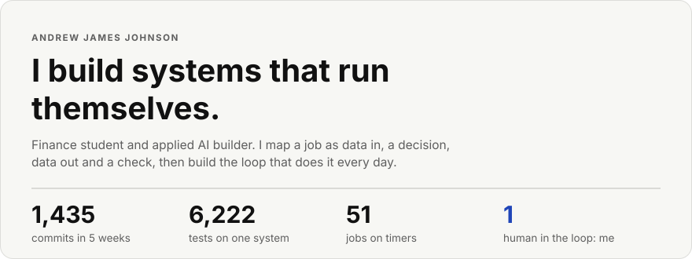

**Finance student. Applied AI builder. Salt Lake City and Chanhassen, MN.**

I grew up around finance, and I do my best work in financial modeling, applied AI and automation. I build systems that do a whole job every day, check their own work, and improve from real results.

**Open to:** 2027 analyst internships and full time roles in finance, defense, government and AI.

## How I build

Everything is a system. Things usually break where two parts meet, even when each part was built right. So every project starts the same way: what comes in, what gets decided, what goes out, and what checks it. **[Loop Engineering](https://github.com/andrewjamesjohnson/loop-engineering)** shows it on one page.

## What I built

| Project | What it does | The loop | Proof |
|---|---|---|---|
| **[The Clip Factory](https://github.com/andrewjamesjohnson/clip-factory)** | A media company that runs itself across YouTube, Facebook, Instagram and TikTok | Find, pick, make, check, **me**, post, measure, learn, repeat | 1,435 commits in 5 weeks, 6,222 tests, 51 jobs on timers |
| **[The Job Bot](https://github.com/andrewjamesjohnson/job-bot)** | An agentic job search: finds the roles, picks the resume, fills the forms | 1,801 boards, filter, score against 5 resumes, fill the form, **I press Submit** | 570 jobs lined up in its first 3 days |
| **[Congress Stock Scorecard](https://github.com/andrewjamesjohnson/congress-stock-scorecard)** | How members of Congress did with their stocks, every market morning | Public filings, prices, estimates, slides, **my phone**, posted | Streams a 15 GB market file through a small C reader each morning |
| **[Loop Engineering](https://github.com/andrewjamesjohnson/loop-engineering)** | The method behind all of it on one page | Prompt, agent, harness, loop, graph | 402 gate refusals in a week, counted by rule |
| **[Finance Models](https://github.com/andrewjamesjohnson/finance-models)** | Portfolio optimizer, bonds, factors and pro formas in plain Python | Inputs, closed form, a numeric check that must agree | Matches Excel's PRICE, YIELD and DURATION |
| **Mac Studio Prepared** *(code private for now)* | A simulated hedge fund of 120+ AI agents built to run on local hardware | Analysts, 53 desks, risk, compliance, audit, every call graded weekly | Runs on open weight models only, nothing leaves the machine |

### The Clip Factory

### The Job Bot

## The rules every project keeps

- **A person approves what goes out.** Code and agents do the work, I make the call.
- **Every rule is a check in code.** A gate answers in fixed words, never an agent's opinion of itself.
- **Every change has an undo,** and ends KEEP, NO EFFECT or ROLL BACK.
- **A failure only gets to happen once.** Then it's a rule.
- **Official APIs and public data only.**

## Recommendation

> "Andrew is naturally curious, persistent, and resourceful."
>
> **Steven E. Orr**, Founder and CEO, Quasar Markets

[Read the full letter (PDF)](https://github.com/andrewjamesjohnson/.github/blob/main/letters/steven-orr-letter.pdf)

## Tools

Anthropic Claude · local open weight models · agent design and orchestration · loop and graph engineering · Python · SQL · Git · Playwright · Advanced Excel · UI/UX

## About

- **Now:** independent, building AI workflows and learning loops for businesses and finance firms
- **Before:** Head of Data Intelligence, Media and Growth at Quasar Markets, the youngest of eight by more than 25 years
- **School:** B.S. Finance, Finance emphasis, University of Utah, expected May 2027
- **Goal:** owning my own compute, four Mac Studios running the largest open weight models locally

[LinkedIn](https://www.linkedin.com/in/andrewj3)
